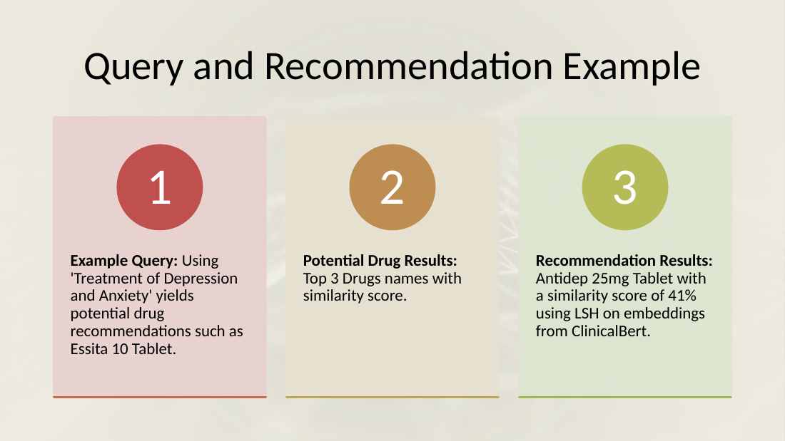

# Automated Drug Prescription System with Biomedical BERT Embeddings and Similarity Search

A retrieval-based medicine recommendation system. Drug and disease descriptions are embedded with **PubMedBERT** and **ClinicalBERT**, and a disease or symptom query is matched to the closest medications with **Locality-Sensitive Hashing (LSH)**, **SimHash** and **FAISS**. The project compares how fast these similarity-search techniques are and which results they return.

<p align="center">
  
</p>

## Problem and Motivation

Manual prescribing is prone to errors such as misdiagnosis and overlooked interactions, and matching diseases to suitable medications by hand is slow. This project explores whether medical language models and scalable similarity search can automate that matching. Given a description of a condition or a set of symptoms, the system retrieves the medications whose descriptions are most similar.

The aims, as stated in the presentation, are to reduce the time clinicians spend on prescription tasks, to reduce human error with NLP, and to standardise prescribing workflows.

## Datasets

| Dataset | Content used | Size | Source |
|---|---|---|---|
| **Dataset 1: Medicine Recommendation System Dataset** | `symtoms_df.csv` (disease → symptoms) and `medications.csv` (disease → medications) | 4,440 records after merging | [Kaggle: noorsaeed/medicine-recommendation-system-dataset](https://www.kaggle.com/datasets/noorsaeed/medicine-recommendation-system-dataset) |
| **Dataset 2: 34,000 Medicine Details** | Drug `Name` and `Uses`, scraped from 1mg.com | 34,109 drugs after filtering | [Kaggle: samoyedzzzzz/34000-medicine-details](https://www.kaggle.com/datasets/samoyedzzzzz/34000-medicine-details) |

The datasets aren't included in this repository. Dataset 2 is downloaded in the notebook with `kagglehub`. Dataset 1 must be downloaded from Kaggle and placed where the notebook expects it (see [Setup and Usage](#setup-and-usage)).

## Approach

1. **Text construction.** Each record is turned into a single descriptive sentence:
   - Dataset 2: *"Drug Name is &lt;Name&gt; Which is used for &lt;Uses&gt;"*. Concatenated use strings are first split back into words with a regex. Only uses shared by at least two drugs are kept.
   - Dataset 1: *"&lt;Disease&gt; have symptoms &lt;S1&gt;, &lt;S2&gt; and &lt;S3&gt; for which &lt;medication&gt; is used to cure."* Here the recommended item is the first listed medication class, such as "Antibiotics".
2. **Query hold-out.** 200 random records per dataset are removed from the searchable data and used as queries: the drug's *uses* for Dataset 2, and three symptoms for Dataset 1.
3. **Embedding.** Texts are embedded in batches into 768-dimensional vectors:
   - **PubMedBERT** (`neuml/pubmedbert-base-embeddings`) with attention-masked **mean pooling**.
   - **ClinicalBERT** (`medicalai/ClinicalBERT`) with the last-layer **[CLS] token**.
   - Queries get the prefix *"Medication for …"*. Embeddings are cached as `.npy` files.
4. **Similarity search** for the top-k medications:
   - **LSH** (`pyLSHash.LSHash`, 8-bit random-projection hash) groups embeddings into buckets and ranks only the candidates in the query's bucket. Its similarity score is `1 / (1 + distance)`.
   - **SimHash** (`pyLSHash.SimHash`) fingerprints the raw texts and scores them by Hamming similarity, with a 0.9 threshold.
   - **FAISS** (`IndexFlatL2`) performs exact Euclidean nearest-neighbour search over all embeddings.

## Results

The numbers below come from the recorded notebook outputs: Dataset 2, 33,909 searchable drugs, Google Colab. The example query is held-out query 50, *"Treatment of Depression, Anxiety disorder, Panic disorder"*, whose actual drug is *Essita 10 Tablet*.

| Technique | Embeddings | Time (index + query) | Top results | Similarity |
|---|---|---|---|---|
| LSH | ClinicalBERT | not timed | Antidep 25mg, Nildep 25mg, Depsol 25mg Tablet | ≈ 0.41 |
| LSH | PubMedBERT | 4.00 s | Uprise-D3 6L Injection (×3) | ≈ 0.003 |
| SimHash | — (raw text) | 44.13 s | Citalin 10, Oxetin 20mg, Hepinz-S | 0.94–0.95 |
| FAISS `IndexFlatL2` | ClinicalBERT | not timed | Antidep 25mg, Nildep 25mg | L2 distance ≈ 1.43–1.46 |
| FAISS `IndexFlatL2` | PubMedBERT | 0.16 s | Citalin 10, Ecitelo 10 | L2 distance ≈ 101–105 |

### Findings
- **Speed:** FAISS exact search was fastest (0.16 s), LSH took 4 s, and SimHash was much slower (44 s) because it re-hashes the entire corpus for every query.
- **Returned drugs:** ClinicalBERT embeddings returned the same top drugs with LSH and FAISS. With PubMedBERT, FAISS returned *Citalin 10*, whose listed uses match the query exactly, while LSH returned one injection three times.
- **SimHash** reaches high similarity because the query wording appears verbatim in the indexed sentences of drugs with the same uses. It measures lexical overlap, not semantic similarity.
- **Comparability:** the similarity values of the three techniques use different scales (`1/(1+L2)` versus Hamming similarity) and different embedding norms, so they aren't directly comparable.
- **Evaluation scope:** the notebook inspects individual example queries. No accuracy or hit-rate metric is computed over the 200 held-out queries.

The presentation summarises the comparison as *LSH: 4 s, similarity 40–45 % (ClinicalBERT) / 2–5 % (PubMedBERT); SimHash: 44.13 s, 90–95 %; "K-Means Clustering": 0.16 s, 40–43 % (ClinicalBERT) / 1–2 % (PubMedBERT)*. The third technique is implemented in the notebook as a FAISS flat L2 index, not as K-Means clustering.

### Future work (from the presentation)
Larger and richer datasets, better handling of ambiguous disease descriptions, user-feedback integration, and improved query generation.

## Tech Stack

- **Language:** Python (the recorded outputs come from a Python 3.10 environment on Google Colab)
- **NLP models:** Hugging Face `transformers`, PubMedBERT, ClinicalBERT, PyTorch
- **Similarity search:** `pyLSHash` (LSH, SimHash), `faiss-cpu`
- **Data:** pandas, NumPy, `kagglehub`

## Setup and Usage

```bash
git clone https://github.com/BasharatWali/Medicine_Rec_System.git
cd Medicine_Rec_System
pip install -r requirements.txt
jupyter notebook notebooks/BDA_Drug_Prescription.ipynb
```

Before running:
- **Kaggle credentials** must be configured for `kagglehub` (see the [Kaggle API docs](https://www.kaggle.com/docs/api)).
- **Paths** are hard-coded for Google Colab/Drive (`/content/drive/MyDrive/BDA_Project/...`). Dataset 1's CSVs are expected in `BDA_Project/Dataset1/`. Change the paths to match your environment.
- **One model at a time:** both models are loaded into the same `tokenizer`/`model` variables. Run the PubMedBERT or ClinicalBERT cell that matches the embeddings you want (`Bert='pubmed'` for mean pooling, otherwise [CLS] pooling).
- **One dataset at a time:** Dataset 1 and Dataset 2 reuse the same variable names (`df`, `Data`, `Names`, `Queries`).
- The notebook is the original project log, so some outputs come from earlier sessions. The markdown cells point this out where it matters.

## Project Structure

```
Medicine_Rec_System/
├── notebooks/
│   └── BDA_Drug_Prescription.ipynb                  # Data prep, embeddings, LSH / SimHash / FAISS search
├── assets/
│   └── query_recommendation_example.png             # Slide 10 of the presentation
├── requirements.txt
├── .gitignore
└── README.md
```

## Author

**Basharat Ali**
